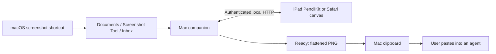

# Architecture

## Components

- `Sources/`: SwiftUI Mac UI, file library, PNG export, clipboard acknowledgement, QR pairing, and Carbon global hotkey. `CaptureSettings` saves/restores only the three screenshot preferences it changes.
- `Companion/server.py`: Python standard-library HTTP service. In public Mac builds, PyInstaller bundles the interpreter. The helper is a child process and exits when its parent ends. It binds loopback and a detected private LAN address, using the first available port in 8765–8785.
- `Companion/app.js`: Safari drawing, palm handling, queue, and local draft storage.
- `NativeiPad/ScreenshotTool/`: native PencilKit canvas, VisionKit scanner, Keychain pairing, local drafts, URLSession transport, and serial queue.

## Pairing and API

The QR URL carries a random pairing key in its fragment. The native app validates the local URL and uses a Bearer header. Safari exchanges the fragment for an HttpOnly, SameSite=Strict cookie. API access requires authentication. Host and Origin checks constrain browser requests. Redirects are rejected by the native client. Do not log pairing links or keys.

| Endpoint | Purpose |
| --- | --- |
| GET `/api/library` | Current-session capture IDs, dimensions, timestamps, saved status, session ID, `supportsSessions` |
| GET `/api/image/{id}` | Authenticated source PNG |
| POST `/api/save` | Validated PNG plus `X-Capture-ID` and UUID `X-Submission-ID` |
| POST `/api/session/reset` | JSON `requestID` UUID; starts a new session and resets the displayed queue while preserving files |
| GET `/api/library/cleanup` | Previous-session PNG count, byte count, and a five-minute confirmation token |
| POST `/api/library/cleanup` | JSON `token` from the preview; moves those previous-session PNGs to Mac Trash |
| GET `/api/status` | Connection and clipboard acknowledgement status |
| POST `/api/pair` | Safari pairing cookie |

Capture IDs are opaque, not filesystem paths. A successful save writes a unique file atomically to Ready, records an idempotency receipt, and writes completion metadata. The Swift Mac process reads that metadata, copies PNG/TIFF/file URL representations to the pasteboard, and acknowledges the completion. Clients only show copied confirmation after that acknowledgement.

Originals are never overwritten. Drawings are flattened at original dimensions. The native client persists drafts and pending requests for recovery. The queue excludes completed captures, retains in-progress work when new captures arrive, and clears the canvas at the end of a batch.

## Sessions and storage cleanup

`sessions.json` in the Mac's application-support directory stores the current session, previous-file identities, and reset receipts. A new session takes a snapshot of every top-level PNG in Inbox, Annotated, and Ready, including files beyond the hundred-image UI limit. It hides those older captures without moving or deleting them. Repeating a reset request UUID returns its original receipt, including after a helper restart, so a dropped response cannot accidentally hide screenshots taken since the reset. Both clients recognize the changed session ID; an unfinished drawing on another client remains editable and can still save while its original exists.

Cleanup is separate from reset. The authenticated preview returns `captureCount`, `fileCount`, `byteCount`, and `token`; only previous-session PNGs qualify. Confirmation rechecks the file set and file identities before moving anything. A stale or expired preview returns HTTP 409 and requires a new preview. Saving an older drawing adds its export to that previous session, so it also invalidates an earlier cleanup preview. Reset, cleanup, image reads, and saves share a lock. A deleted source rejects a new save without deleting the client's local draft; successful save receipts remain available for idempotent retries.

Confirmed files move into a uniquely named **Fatty Lumpkin** folder in the Mac user's Trash, retaining their Inbox/Annotated/Ready subfolders. They can be restored manually in Finder until Trash is emptied. Current-session PNGs, non-PNG files, and symlinks are excluded. The server accepts no client filesystem paths. Cleanup uses atomic moves on the same volume; a library on another volume or unavailable Trash produces an error and should be managed in Finder. A failed batch attempts to restore moved files without overwriting any new files; any remainder stays recoverable in Trash. Confirmation tokens expire on helper restart. There is no automatic retention policy or automatic permanent deletion.

## Current boundaries

Local HTTP is unencrypted. Pairing persists but a changed Mac IP requires a fresh scan. The app is foreground-driven on iPad; it does not promise background delivery while the iPad is asleep. The clipboard contains one latest export, while Ready retains the batch. The server lists at most 100 recent captures; the native canvas caps images at 16 million pixels. No Internet relay, discovery service, analytics, updater, or AI-provider integration is included.
