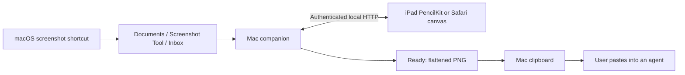

# Architecture

## Components

- `Sources/`: SwiftUI Mac UI, file library, PNG export, clipboard acknowledgement, QR pairing, and Carbon global hotkey. `CaptureSettings` saves/restores only the three screenshot preferences it changes.
- `Companion/server.py`: Python standard-library HTTP service. In public Mac builds, PyInstaller bundles the interpreter. The helper is a child process and exits when its parent ends. It binds loopback and a detected private LAN address, using the first available port in 8765–8785.
- `Companion/app.js`: Safari drawing, palm handling, queue, and local draft storage.
- `NativeiPad/ScreenshotTool/`: native PencilKit canvas, VisionKit scanner, Keychain pairing, local drafts, URLSession transport, and serial queue.

## Pairing and API

The QR URL carries a random pairing key in its fragment. The native app validates the local URL and uses a Bearer header. Safari exchanges the fragment for an HttpOnly, SameSite=Strict cookie. API access requires authentication. Host and Origin checks constrain browser requests. Redirects are rejected by the native client. Do not log pairing links or keys.

| Endpoint | Purpose |
| --- | --- |
| GET `/api/library` | Capture IDs, dimensions, timestamps, saved status |
| GET `/api/image/{id}` | Authenticated source PNG |
| POST `/api/save` | Validated PNG plus `X-Capture-ID` and UUID `X-Submission-ID` |
| GET `/api/status` | Connection and clipboard acknowledgement status |
| POST `/api/pair` | Safari pairing cookie |

Capture IDs are opaque, not filesystem paths. A successful save writes a unique file atomically to Ready, records an idempotency receipt, and writes completion metadata. The Swift Mac process reads that metadata, copies PNG/TIFF/file URL representations to the pasteboard, and acknowledges the completion. Clients only show copied confirmation after that acknowledgement.

Originals are never overwritten. Drawings are flattened at original dimensions. The native client persists drafts and pending requests for recovery. The queue excludes completed captures, retains in-progress work when new captures arrive, and clears the canvas at the end of a batch.

## Current boundaries

Local HTTP is unencrypted. Pairing persists but a changed Mac IP requires a fresh scan. The app is foreground-driven on iPad; it does not promise background delivery while the iPad is asleep. The clipboard contains one latest export, while Ready retains the batch. The server lists at most 100 recent captures; the native canvas caps images at 16 million pixels. No Internet relay, discovery service, analytics, updater, or AI-provider integration is included.
