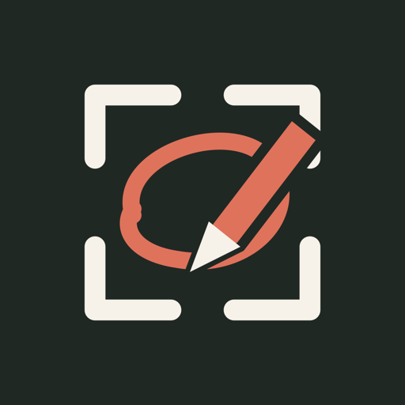

# Getting started

Start at the [website](https://screenshot.bombadillo-ai.com) for the Mac download and iPad invitation.

**Publication status, checked 28 October 2026:** Mac **0.5.1 (14)** is published as [`v0.5.1-beta.1`](https://github.com/MCALLERS/ludwigs-annotated-screenshots/releases/tag/v0.5.1-beta.1); the public download and website were verified. Native iPad **0.5.1 (14)** is **Approved** in the existing **Public Beta** TestFlight group. Build **0.5.1 (17)** adds text/voice notes and further improvements; it was uploaded successfully to App Store Connect and is processing. Public Beta assignment and beta review are not yet complete; tester availability is not confirmed. The full App Store version **1.0** remains **Prepare for Submission**.

## Install on your Mac

1. Follow **Download for Mac** on the [website](https://screenshot.bombadillo-ai.com), or open the verified [Mac 0.5.1 release](https://github.com/MCALLERS/ludwigs-annotated-screenshots/releases/tag/v0.5.1-beta.1) directly. Download `Ludwigs-Annotated-Screenshots-0.5.1-arm64.dmg`. Earlier releases retain the Fatty Lumpkin name.
2. Open it and drag **Ludwig's Annotated Screenshots.app** to **Applications**.
3. Open the app from Applications. Keep it running while you annotate.
4. Click **Set up screenshot folder** if it appears. This changes macOS screenshots to PNG and saves them in **Documents → Screenshot Tool → Inbox**. It preserves the previous location, format, and HDR settings for restoration from the menu-bar app menu.
5. Allow access to Documents and the local network if macOS asks. No Accessibility or Screen Recording permission is needed: macOS’s own screenshot shortcut performs the capture.

### Updating from Fatty Lumpkin

Version 0.5.1 adopts the new name and icon. Quit the old Mac app before opening the new one, and keep only one companion running. Remove the old app bundle from Applications after confirming the new one opens; your screenshot folders and pairing settings live separately and stay in place. Update the existing iPad app through TestFlight to the latest offered build. Its identity and saved pairing remain the same. The existing Mac 0.5.1 download also supports iPad build 17's text notes.

## Connect your iPad

Use the same trusted local network on both devices. Guest networks often prevent devices from communicating.

**Native app:** open the [TestFlight invitation](https://testflight.apple.com/join/bFbsKKmV) on your iPad. Install Apple's TestFlight app if prompted, return to the invitation, and install **Ludwig's Annotated Screenshots**. The renamed **0.5.1 (14)** build is approved for Public Beta. Open the installed app, tap **Connect your Mac**, then **Scan Mac QR code**. On Mac, click **Connect iPad**. Scan that QR code from inside the iPad app. Allow Camera and Local Network access.

**Safari alternative:** scan the Mac QR code with the iPad Camera app and open the link in Safari. Use **Share → Add to Home Screen** to save a shortcut. You can bookmark the paired page too.

The native app remembers its pairing in Keychain. Safari remembers it in its own website storage. Pair them separately if you use both. Do not share a pairing QR code; it contains your local connection key.

## Capture → mark up → paste

1. **Mac:** press **Shift–Command–4**, then drag a rectangle around the area you want to capture. Do not hold Control; that sends the capture to the clipboard instead of a file.
2. **iPad:** the screenshot appears automatically. Draw with Pencil. In the native app, use two fingers to pan and zoom. Turn on **Finger drawing** if you want to draw without Pencil.
3. **iPad:** tap **Done**. Wait for **Copied on your Mac** before pasting. The page/app stays open, ready for the next capture.
4. **Mac:** click your agent’s message field and press **Command–V**. Add a short instruction and send when ready.

If an agent does not accept image paste, drag the PNG from Finder or use **Copy file path** in the Mac app.

## Several screenshots

Take screenshots consecutively. The iPad queues unfinished captures in chronological order. **Done & Next** saves the current annotation and opens the next one. At the end, the iPad clears to the welcome screen. Use **Previous screenshots** to revisit a saved item.

The clipboard contains the most recently completed image. For the whole batch, press **Control–Option–Command–S** on Mac, select the finished PNGs in Finder, then drag them into your agent. Clipboard support for multiple files varies by agent.

## Text and voice notes (native build 0.5.1 (17))

Build 17 is uploaded and processing at Apple; Public Beta assignment and beta review are not yet complete. Once offered, update through TestFlight and check for **Beta 0.5.1 (17)** in the app footer. Safari and earlier native builds do not have this editor.

1. With a screenshot open, tap **Text / voice**, then tap a place on the image.
2. Use the microphone on the iPad keyboard to dictate, or type.
3. Review the words, choose **Small / Medium / Large**, and tap **Add note**.
4. Drag the note to move it; tap it to edit or delete it. **Draw** returns to Pencil.
5. Tap **Done**, wait for **Copied on your Mac**, and press **Command–V** in your chat. The text and Pencil marks are included in the same finished PNG.

Notes stay editable in the local screenshot draft and share Undo/Redo with Pencil marks. If the keyboard microphone is missing, check **Settings → General → Keyboard → Enable Dictation**. See [build 17 details](../NativeiPad/LOCAL-BUILD-17.md).

## Browse earlier screenshots (native iPad 0.4.1+)

These browser controls are included in approved native iPad build **0.5.1 (14)** and later.

Tap **Browse screenshots** to open the screenshot browser. It lists captures oldest first, with search and **All / To do / Saved** filters. **Oldest** and **Newest** jump to either end. The list stays fixed while it is open; close and reopen it to include newly captured screenshots.

Use the left and right arrows above the canvas to move through captures in chronological order. Unfinished Pencil drawings stay with each screenshot when you switch. **Done & Next** still saves to your Mac and advances through the unfinished queue; the navigation arrows simply open another screenshot without exporting it. Build 17 includes a fix for the welcome screen: when no screenshot is open, left opens the newest saved capture and right opens the oldest. In build 14, use Browse from that screen.

## Start fresh or clear older sessions (0.5.0+)

Session controls are included in approved native iPad build **0.5.1 (14)** and later, with Mac **0.5.0** or later.

**Build 17's Clear queue shortcut (introduced in local build 15):** tap **Clear queue** beside **Browse**, then confirm **Clear queue · Reset to 0**. New captures start at 1. Originals and finished PNGs stay on your Mac, and unfinished iPad drawings and text notes remain recoverable in **Browse → To do**. This action deletes no files. It waits for saving and clipboard confirmation, and preserves the current draft before resetting. This shortcut is not in approved build 14.

For the separate session and file-cleanup tools, update both the Mac companion and native iPad app to 0.5.0 or later. On iPad, tap **Session** beside **Browse**.

- **New session · Reset count** clears the visible queue and resets its count to **0 screenshots**. New captures start at 1. Previous originals and finished PNGs stay in their existing Mac folders and remain available in Finder.
- **Review older files…** shows how many previous-session screenshots and files can be cleared, including their size. Confirm **Move files to Mac Trash** only when you no longer need those sessions. The current session is kept. To clear everything currently displayed, start a new session first, then review the older files.
- Finish unfinished drawings with **Done** before using these **Session** tools. An interrupted request can be retried safely. Build 17's **Clear queue** shortcut described above can preserve unfinished drawings and notes instead.

Cleared files are grouped in a **Fatty Lumpkin** folder in your Mac’s Trash, with their Inbox, Annotated, and Ready subfolders. To recover them, open Trash in Finder and move the files back to the corresponding Screenshot Tool folders. Nothing is permanently erased by the app. Emptying Trash is a separate macOS action. Local iPad drawings and cached copies are retained; cleanup manages the Mac screenshot folders.

A session reset is shared with paired clients. If another iPad or Safari window is still drawing, it keeps the unfinished work so it can be saved. Coordinate cleanup when using more than one client.

## Where everything lives

In Finder’s sidebar, choose **Documents**, then **Screenshot Tool**:

| Folder | Contents |
| --- | --- |
| Inbox | Original PNG screenshots |
| Ready | Finished annotations, as separate PNG files |
| Annotated | Working copies retained for compatibility with early previews |

The Mac app also has **Open finished screenshots** and **Open all screenshot folders** buttons. The original folder name stays stable across the branding update.

## After switching everything off

Open the Mac app from **Applications**, then open the iPad app. Normally it reconnects automatically. No USB cable or new scan is needed when the Mac address is unchanged. Keep the Mac awake while working.

If you changed Wi-Fi or the Mac’s IP address changed, quit and reopen the Mac app, click **Connect iPad**, and scan the new code in the iPad app. **Retry** keeps using the old address; use **Scan Mac QR code** for the new one.

## Stop using the workflow

In the Mac menu-bar app menu, choose **Restore previous screenshot settings** before quitting. If no backup exists, use **Shift–Command–5 → Options → Save to** to choose your preferred location. Your images remain in Documents until you remove them yourself.
